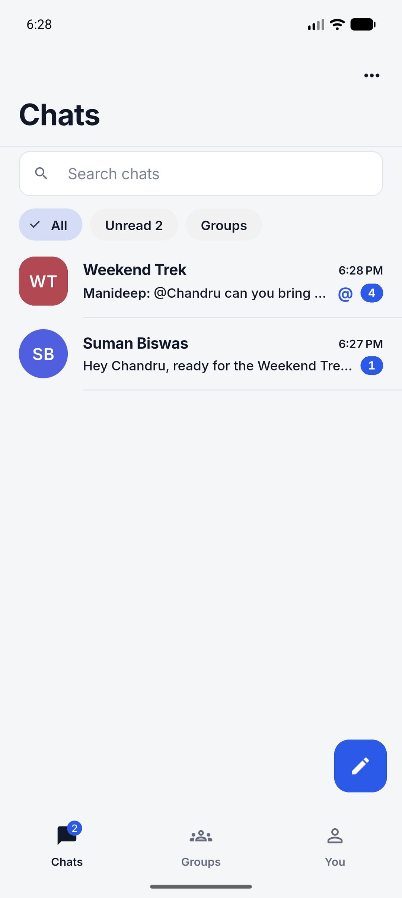
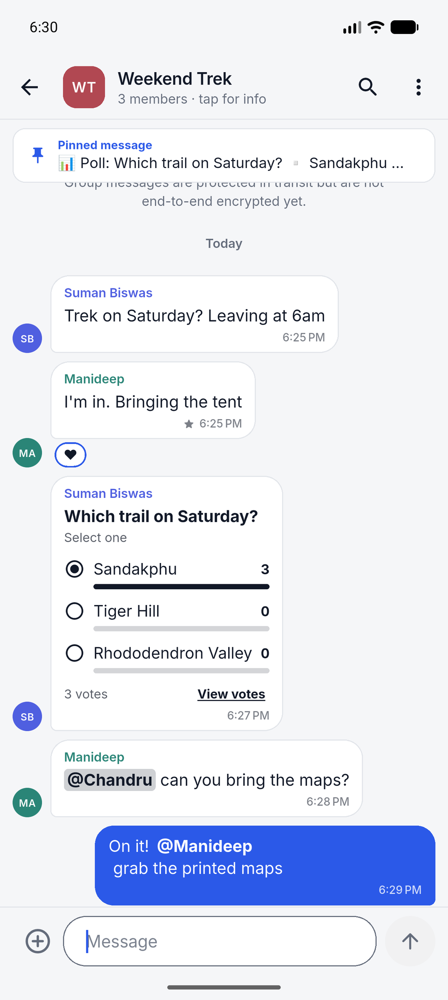
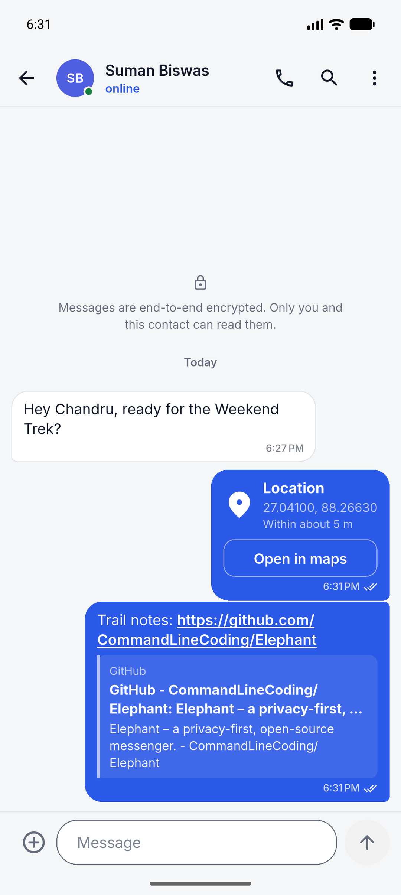
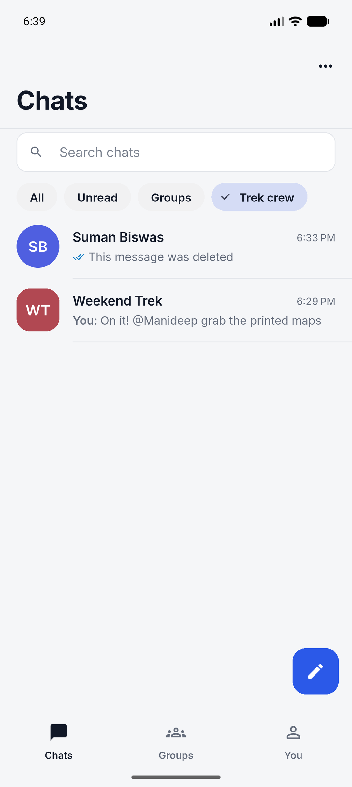
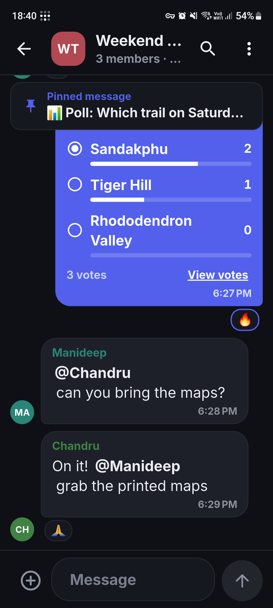
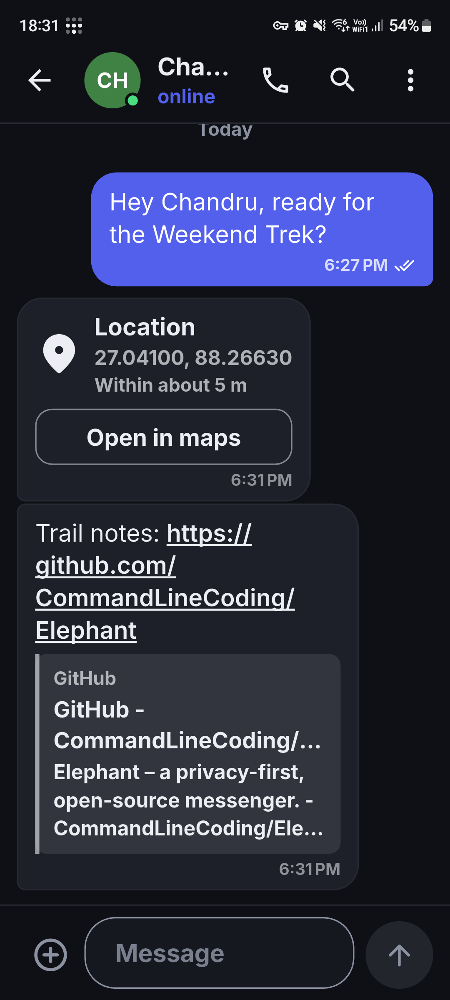
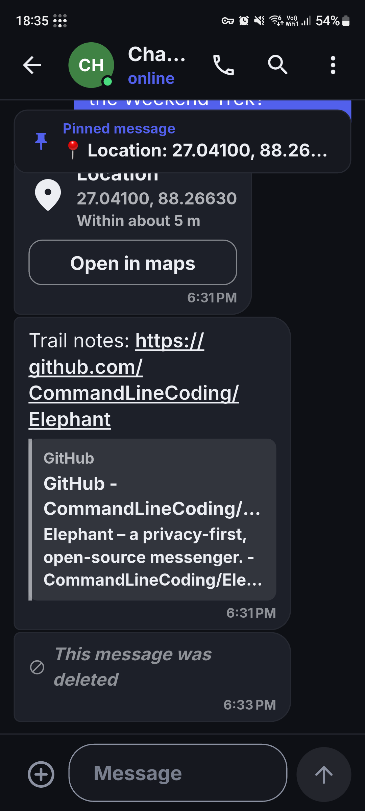
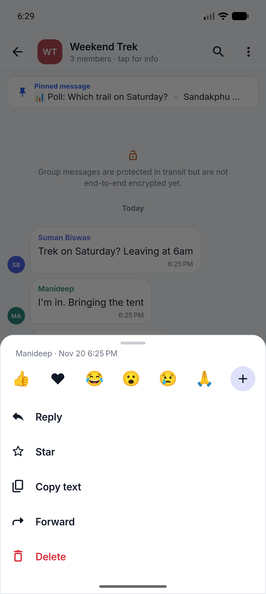
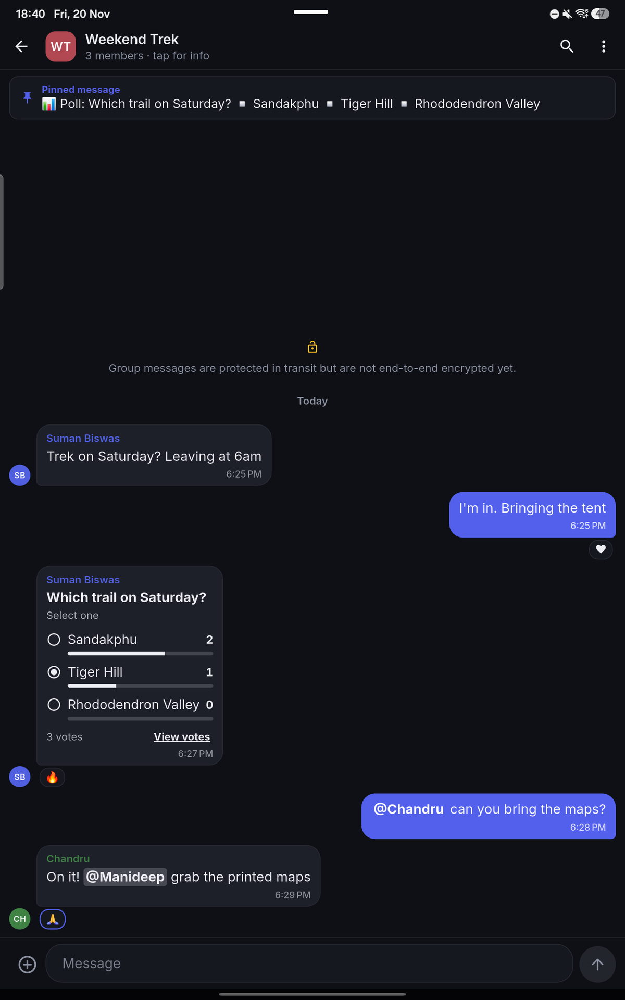

[](https://github.com/commandlinecoding/elephant/releases)
[](https://hub.docker.com/r/commandlinecoding/elephant)
[](https://github.com/commandlinecoding/elephant/actions)
[](LICENSE)

---

# Elephant
Elephant is a privacy-first, open-source messaging application built with Go and Flutter. It offers end-to-end encrypted direct messages based on the Signal Protocol, group chats, and real-time delivery over WebSocket. It also supports password and Google/GitHub sign-in, and keeps an encrypted on-device message store.


## Screenshots

Elephant 0.6.0 on a phone, a tablet and an emulator, with test accounts.

<table>
<tr><td align="center" valign="top"><br><sub>Filters, folders and an @ for mentions</sub></td><td align="center" valign="top"><br><sub>Polls, reactions, stars and @mentions</sub></td><td align="center" valign="top"><br><sub>Location and link preview</sub></td><td align="center" valign="top"><br><sub>Your own folders</sub></td></tr>
<tr><td align="center" valign="top"><br><sub>Group on a phone (dark)</sub></td><td align="center" valign="top"><br><sub>The same chat on the other phone</sub></td><td align="center" valign="top"><br><sub>Deleted for everyone</sub></td><td align="center" valign="top"><br><sub>Message menu</sub></td></tr>
</table>

<p align="center"><br><sub>A group chat on a tablet</sub></p>

More are in [`docs/screenshots/v0.6.0/`](docs/screenshots/v0.6.0/).

## Features

- **End-to-end encrypted direct messages:** The Signal Protocol (X3DH + Double Ratchet, via `libsignal_protocol_dart`) runs on the device. The server only stores public prekey bundles and opaque ciphertext.
- **Contact verification:** Users can mark a contact's identity key as verified. The verification resets automatically if that contact's identity key changes.
- **Voice calls:** One-to-one calls over WebRTC. The call setup (SDP and ICE candidates) is encrypted with the Signal session, so the server can't read it or listen in, and audio goes directly between phones or through a [TURN relay](#calls-and-turn). Calls ring when the app is closed through the same UnifiedPush ping as messages.
- **Group chats:** Groups have admin/member roles, renaming, member management, unread tracking, and typing indicators and read receipts. *Group messages are not yet end-to-end encrypted.*
- **Real-time messaging:** Chat, typing indicators, read receipts and online presence (shown only to people you share a chat or group with) are delivered over a single WebSocket.
- **Message features:** Users can reply/quote messages and edit their own messages within 15 minutes. Paginated history is available for direct and group chats.
- **Chat essentials:** Reactions, polls, pinned and starred messages, @mentions in groups, shared contacts and locations, link previews made on the sender's phone, delete for everyone, delivered and read ticks, drafts, and pin/archive/mute with folders. Stars, drafts, folders and chat settings stay on the device.
- **Notifications (optional):** New-message alerts through [UnifiedPush](https://unifiedpush.org), so no Google services are involved. Install a distributor such as ntfy, then turn them on under Settings → Notifications. The server only sends a tiny ping with no message content, and the notification says who it's from, never what was said.
- **Authentication:** Accounts use a username and password (Argon2id) or Google/GitHub OAuth. Short-lived JWT access tokens are paired with rotating refresh tokens.
- **Offline-first client:** The app keeps a local SQLCipher-encrypted database and queues outgoing messages while offline, then replays them on reconnect.
- **Self-hostable:** The app can point at any Elephant server, which is set from the login screen.

## Tech Stack

| Layer | Technology |
|---|---|
| Backend | Go 1.26 (chi, pgx, gorilla/websocket, golang-jwt, argon2id, golang.org/x/oauth2) |
| Mobile | Flutter (dio, web_socket_channel, provider, sqflite_sqlcipher, flutter_secure_storage, libsignal_protocol_dart, app_links) |
| Database | PostgreSQL 16 |
| CI/CD | GitHub Actions, Docker Compose, GHCR, Docker Hub |

## GitHub Releases (Mobile Apps)

If you only want to install the app, go to the **[GitHub Releases Page](https://github.com/commandlinecoding/elephant/releases)**.

Each release includes Android APKs: a universal build plus per-ABI builds (`arm64-v8a`, `armeabi-v7a`, `x86_64`).

By default, the app connects to the public server at `elephant.commandlinecoding.in`. To use your own server, tap the server indicator on the login screen and enter its host and port.

---

## Quick Start (Docker Compose, recommended)

[compose.yaml](compose.yaml) starts PostgreSQL, applies all database migrations, then starts the published server image. Every container runs as an unprivileged user with all Linux capabilities dropped and a read-only filesystem, and the database sits on a private network: nothing is published to the host except the server's port.

```bash
git clone https://github.com/commandlinecoding/elephant.git
cd elephant

# Copy and fill in environment variables
cp .env.example .env

docker compose up -d
# or: podman-compose up -d
```

This pulls `ghcr.io/commandlinecoding/elephant:latest`. To pin a version or use another image, set `ELEPHANT_IMAGE` in `.env`. The server runs as user and group `1000` by default; set `ELEPHANT_UID` and `ELEPHANT_GID` to change that.

**Developing?** Build the server from your checkout, and reach the database from the host (published on `127.0.0.1` only), by adding [compose.dev.yaml](compose.dev.yaml):

```bash
docker compose -f compose.yaml -f compose.dev.yaml up -d --build
# or: podman-compose -f compose.yaml -f compose.dev.yaml up -d --build
```

Once it's running, verify the server is healthy:

```bash
curl http://HOST:PORT/api/health
```

You should see:

```json
{"success":true,"data":{"postgres":"up","timestamp":"..."}}
```

## Running the Published Image

Prebuilt server images are published on every version tag. The image runs **only** the server binary, so you must provide a PostgreSQL 16 database. The server applies any pending [database migrations](#database-migrations) itself when it starts.

#### Docker Hub
```bash
docker run --name elephant-server \
  -e PORT=3000 \
  -e POSTGRES_HOST=host.docker.internal \
  -e POSTGRES_PORT=5432 \
  -e POSTGRES_USER=your_db_user \
  -e POSTGRES_PASSWORD=your_db_password \
  -e POSTGRES_DB=your_db_name \
  -e JWT_SECRET=a_secure_random_secret_of_at_least_32_chars \
  -p 3000:3000 \
  -d commandlinecoding/elephant:latest
```

#### GitHub Container Registry
```bash
podman run --name elephant-server \
  -e PORT=3000 \
  -e POSTGRES_HOST=host.containers.internal \
  -e POSTGRES_PORT=5432 \
  -e POSTGRES_USER=your_db_user \
  -e POSTGRES_PASSWORD=your_db_password \
  -e POSTGRES_DB=your_db_name \
  -e JWT_SECRET=a_secure_random_secret_of_at_least_32_chars \
  -p 3000:3000 \
  -d ghcr.io/commandlinecoding/elephant:latest
```

To enable Google/GitHub sign-in, also pass the `GOOGLE_*` / `GITHUB_*` variables listed in [Environment Variables](#environment-variables).

> The server speaks plain HTTP/WS. In production, put it behind a TLS-terminating reverse proxy (e.g. Caddy or nginx) that forwards WebSocket upgrades on `/api/ws`.

## Local Development

### Running the backend without Docker

```bash
cd server
go mod download
go run main.go
```

The server looks for a `.env` file in the current directory and every parent directory, so the repo-root `.env` is picked up automatically. Make sure PostgreSQL is reachable with the `POSTGRES_*` values. Pending migrations are applied when the server starts.

### Database Migrations

SQL migrations live in [server/migrations/](server/migrations/) as numbered `NNN_*_up.sql` files, and are embedded in the server binary. **When the server starts it applies every pending migration**, in order, each in its own transaction, and records it in a `schema_migrations` table. It takes a database lock first, so several instances starting at once are safe, and a failing migration stops startup instead of leaving the schema half-updated.

- **Existing databases.** If a database already has the tables but no `schema_migrations` history (for example, one set up by hand), the server checks which migrations are already present, records those, and applies only what's missing.
- **Turning it off.** Set `AUTO_MIGRATE=false` if the database user isn't allowed to change the schema, and apply the files yourself.
- **Docker Compose** also runs [server/migrate.sh](server/migrate.sh) through the `migration` service before starting the server. Both use the same `schema_migrations` table, so they never repeat each other's work.

To apply migrations without starting the server:

```bash
docker run --rm \
  -v ./server/migrations:/migrations:z \
  -v ./server/migrate.sh:/migrate.sh:z \
  -e POSTGRES_HOST=<db host> -e POSTGRES_PORT=5432 \
  -e POSTGRES_USER=<user> -e POSTGRES_PASSWORD=<password> -e POSTGRES_DB=<db> \
  postgres:16-alpine sh /migrate.sh
```

### Running the mobile app

```bash
cd mobile
flutter pub get
flutter run
```

See [mobile/README.md](mobile/README.md) for details on pointing the app at a local server and on how the client is structured.

## Environment Variables

| Variable | Description | Default |
|---|---|---|
| `HOST` | Host shown in the startup log. The server binds to `0.0.0.0` when this is `localhost`, `127.0.0.1` or empty | `127.0.0.1` |
| `PORT` | Server port | `3000` |
| `POSTGRES_USER` | Database username | `postgres` |
| `POSTGRES_PASSWORD` | Database password | `very_strong_password` |
| `POSTGRES_DB` | Database name | `myapi_db` |
| `POSTGRES_PORT` | Database port | `5432` |
| `POSTGRES_HOST` | Database host | `localhost` |
| `JWT_SECRET` | Secret key for signing JWTs (HS256). **Always set this**, because the built-in default is public | `default-long-safe-secret-key-string` |
| `ARGON_MEMORY` | Argon2id memory cost (KiB) | `65536` |
| `ARGON_ITERATIONS` | Argon2id iteration count | `3` |
| `ARGON_MAX_CONCURRENT` | How many password hashes may run at once. Each uses `ARGON_MEMORY` of RAM, so this caps the memory a burst of sign-ins can take (the default of 2 stays under about 300 MB). Extra requests wait up to 10 s, then get a `503` | `2` |
| `ARGON_PARALLELISM` | Argon2id parallelism degree | `2` |
| `GOMEMLIMIT` | Soft memory limit for the Go runtime, about 80% of the container's memory (e.g. `400MiB` for a 512 MB container). Go otherwise keeps the memory it grew to after a burst of work. Set to `off` to disable | `400MiB` |
| `AUTO_MIGRATE` | Apply pending database migrations when the server starts. Set to `false` to manage them yourself | `true` |
| `GOOGLE_CLIENT_ID` | Google OAuth client ID | — |
| `GOOGLE_CLIENT_SECRET` | Google OAuth client secret | — |
| `GOOGLE_REDIRECT_URL` | Google OAuth callback URL, e.g. `https://HOST/api/auth/google/callback` | — |
| `GITHUB_CLIENT_ID` | GitHub OAuth client ID | — |
| `GITHUB_CLIENT_SECRET` | GitHub OAuth client secret | — |
| `GITHUB_REDIRECT_URL` | GitHub OAuth callback URL, e.g. `https://HOST/api/auth/github/callback` | — |
| `REGISTRATION` | `open` lets anyone create an account. `closed` refuses new accounts (username sign-up and new Google/GitHub accounts); existing users can still sign in. Any other value stops the server from starting | `open` |
| `CLEANUP_INTERVAL_MINUTES` | How often the server deletes expired data (sign-in tokens that ran out, push endpoints that keep failing). With several servers on one database only one cleans at a time. `0` turns it off | `10` |
| `PUSH_ALLOW_PRIVATE_ENDPOINTS` | Let users register [UnifiedPush](https://unifiedpush.org) endpoints on private or loopback addresses over plain HTTP, e.g. a self-hosted ntfy on your LAN. Off by default so the server can't be pointed at your internal network | `false` |
| `STUN_URLS` | Comma-separated STUN servers for calls. Set it empty for none (calls then only connect on the same network) | `stun:stun.cloudflare.com:3478` |
| `TURN_URLS`, `TURN_SECRET` | Your own [coturn](#calls-and-turn) relay: its URLs (e.g. `turn:turn.example.org:3478?transport=udp,turn:turn.example.org:3478?transport=tcp`) and its `static-auth-secret` | — |
| `CLOUDFLARE_TURN_KEY_ID`, `CLOUDFLARE_TURN_API_TOKEN` | Use [Cloudflare's TURN service](https://developers.cloudflare.com/realtime/turn/) instead of your own relay. Takes precedence over `TURN_URLS` | — |
| `TURN_USERNAME`, `TURN_PASSWORD` | A hosted TURN service with a fixed login, with its URLs in `TURN_URLS`. Used when `TURN_SECRET` isn't set | — |

See [.env.example](.env.example) for a starting template. With [compose.dev.yaml](compose.dev.yaml), `POSTGRES_PORT` sets the **host** port that the database is published on (on `127.0.0.1` only); the default compose file doesn't publish it at all. The server always connects to `db:5432` inside the network.

### Calls and TURN

Voice calls connect the two phones directly when they can. On mobile data they often can't, and the audio has to go through a TURN relay. The relay only ever sees encrypted audio. The server hands the app TURN credentials at the start of each call (`GET /api/calls/ice-servers`). There are three ways to provide a relay:

- **Cloudflare TURN.** Create a TURN key in the Cloudflare dashboard (Realtime → TURN) and set `CLOUDFLARE_TURN_KEY_ID` and `CLOUDFLARE_TURN_API_TOKEN`. Cloudflare's free tier covers 1,000 GB of relayed traffic a month; a relayed hour of voice is roughly 20–45 MB.
- **Your own coturn.** It needs UDP, so it can't run on HTTP-only hosts such as Render. Set `TURN_SECRET` (a long random string), `TURN_EXTERNAL_IP` (your server's public IP) and `TURN_URLS` in `.env`, then start it with the `calls` profile:

  ```bash
  docker compose --profile calls up -d
  ```

  Open these ports in your firewall: `3478/udp` and `3478/tcp` (STUN and TURN), and `49160-49200/udp` (relayed audio, about 40 simultaneous relayed calls). coturn runs on the host's network and refuses to relay into private address ranges, so it can't be used to reach your internal network.

- **A hosted TURN service with a fixed login.** Some have free plans with no card and no charges beyond the free allowance, for example [Metered Open Relay](https://metered.ca/tools/openrelay/) (20 GB a month). Sign up, then set `TURN_URLS` to the URLs it gives you (comma-separated) and `TURN_USERNAME`/`TURN_PASSWORD` to its username and password. Every signed-in user receives the same login, so someone could reuse it against your allowance; when it runs out, calls fall back to connecting directly.

With none of these, calls use STUN only. That's enough on most Wi-Fi and home networks, but many calls on mobile data won't connect.

## API

Check out the [API documentation](docs/API_CONTRACTS.md) for every REST endpoint, the WebSocket event protocol, and the E2EE key-distribution endpoints.

### Registration note

Usernames are normalized to lowercase and always given a random 4-digit discriminator, e.g. registering as `abc` results in a username such as `abc.4821`. Log in with the full username returned in the registration response. OAuth accounts get a username derived from the email handle in the same format.

## Testing

Run the backend checks and test suite:

```bash
cd server
go vet ./...
go test -v ./...
```

Some tests need a live database and server: the repository tests, the controller tests, and the integration tests under [server/tests/](server/tests/). Start the stack first (and apply migrations), then run:

```bash
HOST=$HOST PORT=$PORT go test -v ./tests/...
```

For the mobile app:

```bash
cd mobile
flutter analyze
```

### CI/CD

| Workflow | Trigger | What it does |
|---|---|---|
| [backend.yaml](.github/workflows/backend.yaml) | Every push and PR | `go vet`, staticcheck, then starts PostgreSQL + server and runs `go test ./...` |
| [release.yaml](.github/workflows/release.yaml) | `v*` tag | Builds and pushes the server image to GHCR |
| [docker-release.yaml](.github/workflows/docker-release.yaml) | `v*` tag | Builds and pushes the server image to Docker Hub |
| [android-release.yaml](.github/workflows/android-release.yaml) | `v*` tag | Runs `flutter analyze`, builds universal and split-ABI APKs, and attaches them to the GitHub Release |

## Project Structure

```
elephant/
├── .github/                  # Issue forms, PR template and GitHub Actions workflows
├── docs/
│   └── API_CONTRACTS.md      # REST, WebSocket and E2EE API reference
├── metadata/                 # F-Droid / store listing metadata
├── mobile/                   # Flutter client (see mobile/README.md)
│   ├── android/
│   ├── ios/
│   ├── assets/
│   ├── lib/
│   └── pubspec.yaml
├── server/                   # Go backend
│   ├── config/               # Router, DB pool, Argon2, OAuth configuration
│   ├── controllers/          # HTTP and WebSocket handlers
│   ├── env/                  # Environment variable loading (.env lookup)
│   ├── errors/               # Error definitions
│   ├── middlewares/          # Auth, group membership/admin guards, CORS, logging, rate limiting
│   ├── migrations/           # Numbered SQL migrations (*_up.sql)
│   ├── models/               # Request/response and domain models
│   ├── repository/           # Database access layer
│   ├── routes/               # Route definitions (/auth, /users, /messages, /groups, /e2ee)
│   ├── services/             # Business logic (auth, JWT, OAuth, messages, E2EE, WebSocket hub)
│   ├── tests/                # Integration tests
│   ├── migrate.sh            # Standalone migration runner (also used by Docker Compose)
│   └── Dockerfile
├── compose.yaml              # PostgreSQL + migrations + the published server image (hardened)
├── compose.dev.yaml          # Development additions: build from source, database on 127.0.0.1
├── .env.example              # Environment variable template
├── CONTRIBUTING.md
├── SECURITY.md
├── CODE_OF_CONDUCT.md
└── LICENSE
```

## Contributing

Contributions are welcome, and you don't need to know cryptography to help. Read [CONTRIBUTING.md](CONTRIBUTING.md) for setup, how to claim an issue, and how to open a PR.

- New here? Pick a [`good first issue`](https://github.com/CommandLineCoding/Elephant/issues?q=is%3Aissue+is%3Aopen+label%3A%22good+first+issue%22).
- See what's planned on the [roadmap board](https://github.com/orgs/CommandLineCoding/projects/3) and in the [milestones](https://github.com/CommandLineCoding/Elephant/milestones).
- Questions and ideas go in [Discussions](https://github.com/CommandLineCoding/Elephant/discussions).

Please also read the [Code of Conduct](CODE_OF_CONDUCT.md). To report a security issue, follow [SECURITY.md](SECURITY.md) instead of opening a public issue.

## License

Elephant is licensed under the AGPL-3.0. See [LICENSE](LICENSE) for details.
